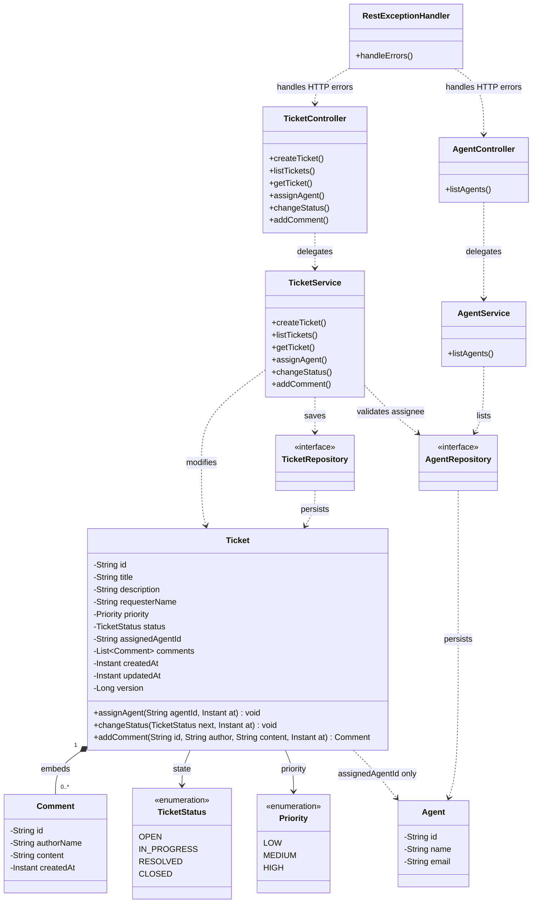

# TicketFlow — Object-Oriented Design and UML

**Status:** Approved conceptual design, reconciled after design review R1–R4 (19 November 2026)  
**Source:** Human decisions D7–D14, D15–D19, and review approvals R1–R4. No Java code has been implemented by this design activity.

## UML class diagram

The signatures are **conceptual**. Controllers accept request DTOs and return response DTOs rather than using the persistence classes as network payloads. The association to `Agent` is an ID reference, **not** embedded object storage. `Comment` is a Java class embedded in `Ticket`, **not** a standalone MongoDB collection.

## Responsibilities and boundaries

| Component | Responsibility |
|---|---|
| `Ticket` | Aggregate root: enforces state transitions, closed-ticket immutability, one assignee and embedded comment rules. Its collection of comments is not publicly mutable. |
| `Comment` | Embedded value containing backend-generated ID, author, content and timestamp. |
| `Agent` | Separate MongoDB document representing an existing support agent; demo agents are seeded. |
| `TicketService` | Loads/saves tickets, generates IDs and time, verifies `expectedVersion` against current ticket, verifies agent existence, invokes domain methods and maps to ticket DTOs. |
| `AgentService` | **Read-only** use case for listing available agents; delegates to `AgentRepository` and returns agent summary DTOs. |
| `TicketController` | **Six ticket routes:** create, list, details, assign, status, comment. Handles HTTP routing and request validation; does not implement ticket rules. |
| `AgentController` | **One route:** `GET /api/agents`; delegates to `AgentService`; no agent admin functions. |
| `TicketRepository` / `AgentRepository` | Spring Data MongoDB persistence; `TicketRepository` uses `@Version` to detect stale document saves. |
| `RestExceptionHandler` | Centralized Problem Details for validation errors, not-found errors, business rule conflicts and optimistic-lock conflicts. |

## Domain rules and validation

- New `Ticket` starts `OPEN`, unassigned, no comments; priority is selected at creation and cannot be edited later.
- Allowed transitions: `OPEN → IN_PROGRESS → RESOLVED → CLOSED`; also `RESOLVED → IN_PROGRESS` to reopen. An assignee is required before entering `IN_PROGRESS`. `CLOSED` is terminal.
- Only explicit `assignAgent()`, `changeStatus()` and `addComment()` methods modify controlled state.
- Domain constructors and methods enforce nonblank and maximum text sizes: ticket title **120**, description **2000**, requester name **100**; comment author **100** and content **2000** characters. The API DTOs enforce the same limits on incoming requests. Whitespace is trimmed before nonblank/length checks.
- `TicketService` checks an agent exists before calling `Ticket.assignAgent()`. The domain `Ticket` does not access MongoDB directly.
- Ticket version (`Long` annotated `@Version` during implementation) is persistence-managed; `TicketService` checks `expectedVersion` and catches stale-save conflicts. The domain does not expose a version setter.
- Use controllable clock/UUID generation for deterministic domain/service tests.

## Trade-offs confirmed in design review

- **R1 — Additional agent service/controller:** two small classes, but consistent controller-to-service-to-repository separation and independent test boundaries.
- **R2 — Text size limits:** bounded inputs make validation predictable and constrain MongoDB document growth; limits are product choices that may need future revision.
- **R3 — Explicit acceptance targets:** extra test effort, but results become objectively assessable.
- **R4 — Controlled demo:** reduced public accessibility; avoids exposing an unauthenticated write API.

## Delivery note

This UML describes the **design baseline**, not compiled signatures or verified behavior. During Phase 3, update the diagram if actual code differs, and document why. No separate `CommentRepository` or third collection is needed.
