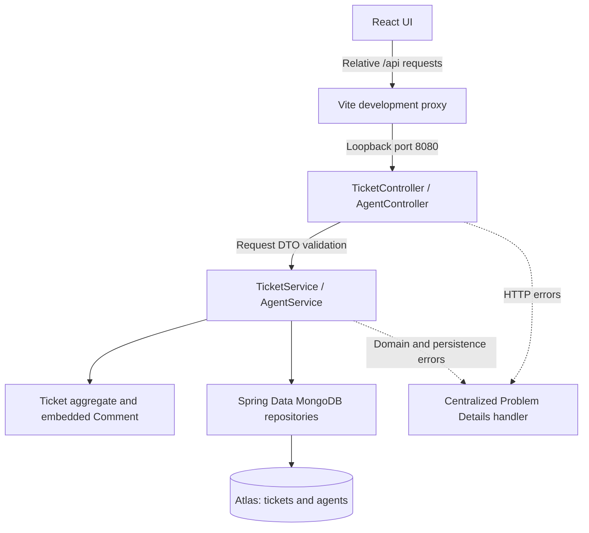

# TicketFlow — System Architecture

Current implementation overview, 26 November 2026, derived from [ADR-001](../decisions/ADR-001.md), [D1–D25 and R1–R4](../PHASE2_ENGINEERING_DECISIONS.md) and repository structure. This overview supplies the architecture document missing after the mislabeled API file was renamed; it is not a new human decision or a production deployment claim.

## Responsibilities and integrity

One Spring Boot backend is organized by `ticket` and `agent` features, with shared `config`. Controllers handle HTTP input/output through DTOs. Services coordinate repositories, agent existence, backend UUID/time generation and response mapping. Ticket domain methods enforce status, assignment, comments and CLOSED immutability. Repositories persist documents; no JPA or separate comment collection is used.

Each mutation carries the last received `expectedVersion`; service preconditions reject stale browsers, while `@Version` protects the read/save race. Both return safe HTTP 409 responses. The UI offers explicit reload/retry and does not silently replay mutations. String UUIDs, BSON dates and embedded comments follow the [data model](MONGODB_DATA_MODEL.md). See [conceptual UML](OBJECT_ORIENTED_DESIGN.md) and [seven-route API contract](REST_API_CONTRACT.md).

## Configuration boundaries

The application reads `MONGODB_URI` through `spring.mongodb.uri`, binds to loopback, and disables demo seeding by default. Opt-in seeding inserts missing agents by stable IDs and preserves existing records. The development proxy is not a production gateway. Authentication and role enforcement are outside this MVP; requester/agent names are not verified identities.

Default Maven tests exclude database contexts. The separate integration profile validates explicit authorization, confirmed database name and matching URI, majority writes and primary reads. IT-01 adds only the exact authorized `ticketflow_test` name; it does not authorize `ticketflow_dev`. Empty tickets/agents are required before test writes, and test data is retained. See [TIC-10 final verification](../TIC10_VERIFICATION.md).

## Phase 2 filename correction

The original contents were preserved during these corrections:

| Original filename | Correct destination based on internal content |
|---|---|
| `SYSTEM_ARCHITECTURE (1).md` | [REST_API_CONTRACT.md](REST_API_CONTRACT.md) |
| `REST_API_CONTRACT (1).md` | [OBJECT_ORIENTED_DESIGN.md](OBJECT_ORIENTED_DESIGN.md) |
| `OBJECT_ORIENTED_DESIGN (1).md` | [MONGODB_DATA_MODEL.md](MONGODB_DATA_MODEL.md) |
| `MONGODB_DATA_MODEL (1).md` | Byte-identical duplicate consolidated into [DESIGN_REVIEW.md](DESIGN_REVIEW.md) |

The three renamed documents retained identical content hashes during the move. The review copy was removed only after an exact hash comparison. Phase 2 documents describe the historical 19 November design baseline; current test results are recorded separately.
